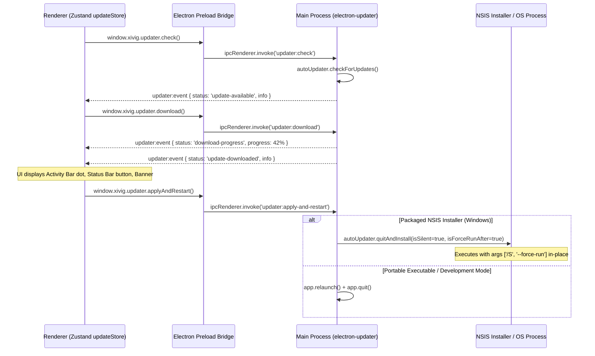

# Xivig Text Editor — In-Place Seamless Auto-Updater 🔄

This document details the architecture, IPC event pipeline, user experience, and silent in-place installation workflow for **Xivig Text Editor 2.0.2**.

---

## 1. Overview & Design Philosophy

The auto-update system in Xivig is modeled directly after **Visual Studio Code**'s seamless update experience:

* **Zero Wizard Interruptions**: No manual installer wizards, no Next-Next-Finish dialogs, and no manual downloads from browser windows.
* **Silent Background Retrieval**: Updates are detected and downloaded asynchronously in the background without degrading editor responsiveness.
* **In-Place Application on Restart**: Once downloaded and verified, the update is applied immediately upon restarting Xivig—either via a single click on the update notifications or naturally on the next application launch.
* **Multi-Surface Status Awareness**: Clear, synchronized status indicators across the top notification banner, Activity Bar Settings gear icon, Status Bar, and Command Palette.

---

## 2. User Experience & Indicators

```
┌─────────────────────────────────────────────────────────────────────────────┐
│ 🔄 Xivig Update Ready: Version 2.0.2 is ready. [ ⟳ Restart Xivig to Update ] │
├──────┬──────────────────────────────────────────────────────────────┬───────┤
│ 📁   │                                                              │       │
│ 🔍   │  Code Editor                                                 │       │
│ 🌿   │                                                              │       │
│ 🧩   │                                                              │       │
│      │                                                              │       │
│ ⟳ v  │                                                              │       │
│ ⚙️ ● │                                                              │       │
├──────┴──────────────────────────────────────────────────────────────┴───────┤
│ main*  Ln 12, Col 4  Spaces: 2  UTF-8  LF  TypeScript  [ ⟳ Restart to Update ]│
└─────────────────────────────────────────────────────────────────────────────┘
```

### 1. Top Notification Banner
* Displays version notes, release tags, and current download progress (`0% - 100%`).
* Transitions from "Downloading update..." to **"Restart Xivig to Update"** with an instant action button and dismiss toggle.

### 2. Activity Bar Settings Gear Badge
* Displays an indicator dot (`#35b779`) over the Settings gear button when an update is downloaded.
* Hovering reveals: `"Update Ready: Restart Xivig to apply update"`.
* Dedicated `[⟳]` action button appears above the gear icon for one-click restart.

### 3. Status Bar Action
* When ready, an interactive item appears in the right section of the status bar:
  `[ ⟳ Restart to Update ]`
* Clicking immediately invokes silent in-place installation and relaunches the editor.

### 4. Command Palette (`Ctrl+Shift+P` / `F1`)
* `Help: Check for Updates...`: Triggers an immediate check against the release channel.
* `Help: Restart to Update (Apply Downloaded Update)`: Triggers immediate silent in-place restart.

---

## 3. Architecture & IPC Flow



### IPC Channel Registry

| Channel | Type | Direction | Payload | Description |
|---|---|---|---|---|
| `updater:check` | Invoke | Renderer ➔ Main | `none` | Starts background version check. |
| `updater:download` | Invoke | Renderer ➔ Main | `none` | Starts background asset download. |
| `updater:apply-and-restart` | Invoke | Renderer ➔ Main | `none` | Silently installs downloaded package and relaunches. |
| `updater:event` | Send | Main ➔ Renderer | `UpdateEventPayload` | Broadcasts update lifecycle events. |

---

## 4. Silent In-Place Execution Details

### Windows NSIS Installer
In `electron/main/updater/index.ts`:
```typescript
// Silent execution flags: /S (Silent), --force-run (Launch immediately after upgrade)
(autoUpdater as any).quitAndInstallArgs = ['/S', '--force-run'];
autoUpdater.quitAndInstall(false, true);
```
* **`/S`**: Suppresses all wizard dialogs and confirmation screens.
* **`--force-run`**: Guarantees the newly updated binary launches immediately after files are copied.
* **`isSilent: false` to quitAndInstall**: Prevents Windows from showing secondary confirmation dialogs while honoring the `/S` flag.
* **`isForceRunAfter: true`**: Relaunches the updated executable into the active user session.

### Portable & Development Fallback
For unpacked builds, portable `.exe` executions, and local development:
```typescript
if (!app.isPackaged || isPortableExecution) {
  app.relaunch();
  app.exit(0);
}
```

---

## 5. Zustand Central Store (`src/stores/updateStore.ts`)

The updater state is centrally managed via Zustand:
* `isChecking: boolean`: Active release check state.
* `isDownloading: boolean`: Asset download state.
* `isApplying: boolean`: Restarting / applying state.
* `downloadProgress: number`: Percentage completed (`0` to `100`).
* `updateInfo: UpdateReleaseInfo | null`: Release metadata (version, notes, date).
* `downloadedInfo: UpdateReleaseInfo | null`: Staged binary ready for restart.
* `statusMessage: string | null`: User-facing notification message.
* `isBannerDismissed: boolean`: Banner visibility preference.

---

## 6. Verification & Automated Testing

Automated test suites in `src/__tests__/autoUpdater.test.ts` verify:
1. `useUpdateStore` initial defaults.
2. Listener initialization and IPC event mapping.
3. Event handling for `update-available`, `download-progress`, `update-downloaded`, and `error`.
4. Action execution for `checkForUpdates`, `startDownload`, and `applyAndRestart`.
5. Error recovery and graceful offline fallbacks.
